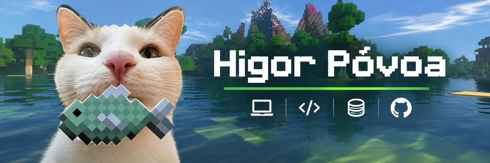
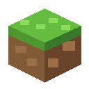
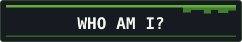
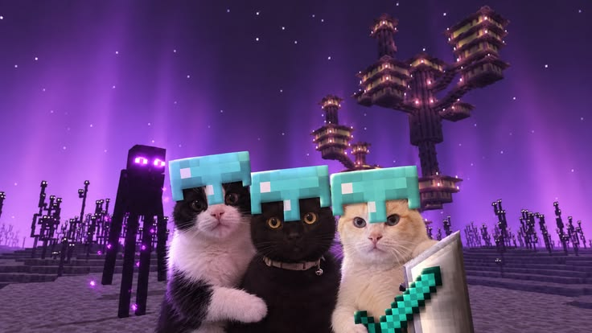
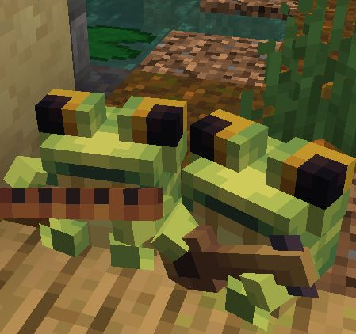
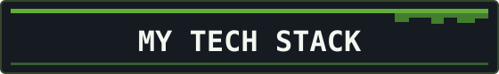

  

  
  &nbsp;
  
  &nbsp;
  

  
  &nbsp;
  
  &nbsp;
  

  
  I'm <strong>Higor Póvoa</strong>, and I'm building my journey in <strong>technology</strong>, with a special interest in <code>software development</code> and discovering new ways to turn ideas into real projects. I enjoy exploring different technologies, understanding how systems work, and finding creative solutions to everyday challenges.

  I like putting what I learn into practice through personal projects, experiments, and continuous improvement. My toolbox includes <strong>HTML</strong>, <strong>CSS</strong>, <strong>JavaScript</strong>, <strong>Python</strong>, <strong>PHP</strong>, <strong>C#</strong>, and technologies for working with <strong>databases</strong> and web applications. For me, every new challenge is an opportunity to learn something useful and build something better.

  Beyond technology, I also enjoy the creative world of <strong>Minecraft</strong>, where even the biggest ideas begin with a single block. I bring that same mindset to my projects: explore possibilities, learn from mistakes, and keep improving. My goal is to continue developing my skills and creating software that makes a difference — <strong>one block of code at a time.</strong>

 
 

  <strong>YOU CAN CLICK HERE</strong>
    
  
  &nbsp;
  
  &nbsp;
  <!-- Substitua SEU-USUARIO-AQUI pelo endereço real do LinkedIn do Higor. -->
  

<table align="center" width="100%">
  <tr>
    <td width="4" bgcolor="#67B344"></td>
    <td valign="middle">
      <strong>Behind the Blocks</strong>
        
      I'm constantly learning, creating, and turning ideas into something real. 
      Every project is a new world to explore — a chance to experiment, overcome challenges, and build something better.
    </td>
    <td width="130" align="center" valign="middle">
      
    </td>
  </tr>
</table>

  
  &nbsp;
  
  &nbsp;
  

<table align="center" width="100%">
  <tr>
    <td width="46%" valign="middle" align="center">
      
    </td>
    <td width="54%" valign="middle" align="center">
      
    </td>
  </tr>
</table>

  

  
    
  <em>“Every great build begins with a single block. Keep exploring, keep creating, and make your own world.”</em>
    
  

